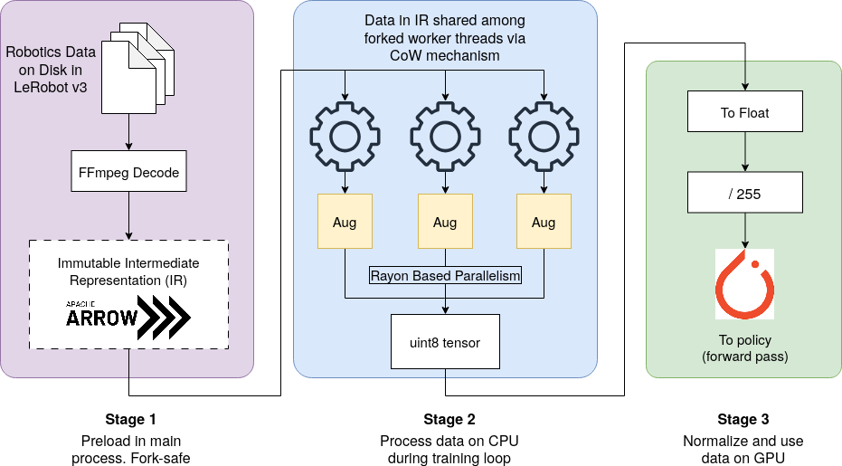

<div align="center">

# data-core

**A blazing-fast Rust dataloader that drops straight into your LeRobot workflow.**

[](https://github.com/PAIR-data-platform/data-core-rs/actions/workflows/ci.yml)
[](LICENSE)

[](https://openreview.net/forum?id=Vv1WXMkSTD)
[](https://pair-data-platform.github.io/data-core-rs/)

[**Get started**](GETTING_STARTED.md) · [Paper](https://openreview.net/forum?id=Vv1WXMkSTD) · [Project page](https://pair-data-platform.github.io/data-core-rs/) · [Features](FEATURES.md)

</div>

---

data-core reads your [LeRobot](https://github.com/huggingface/lerobot) v3
datasets (v2 too), decodes the video **once** into zero-copy
[Apache Arrow](https://arrow.apache.org/) buffers, shares that single copy with
every DataLoader worker, and augments frames in Rust. A frame read is a memory
lookup instead of a video seek, so data loading stops being something you have
to think about.

| **3.94×** | **~1000×** | **1.83×** | **1 copy** |
|:---:|:---:|:---:|:---:|
| the throughput of torchcodec | lower single-frame access latency | faster than torchcodec + torchvision v2 under heavy augmentation | of the dataset, shared by all workers |

<sub>Isolated benchmarks from the paper: single process, 4-camera 480×640
dataset. Latency is about 0.8 µs from the cache against about 800 µs for an
unindexed disk read. How this translates to training time is covered in
[What to expect end to end](#what-to-expect-end-to-end).</sub>

> **Straight talk.** We built data-core to be as fast as we could make it, then
> measured whether it shortens policy training. With torchcodec or data-core,
> the GPU waits on data for only 1 to 3.5% of each step, so in standard LeRobot
> setups end-to-end wall-clock time does not measurably change. What you get is
> a loader that is never the problem, plus the memory, safety and augmentation
> features below, plus the tooling to check all of this on your own setup.

## Why data-core

- **Fast where it counts.** After a one-time decode, reading a frame is an O(1)
  lookup into an Arrow buffer: about 0.8 µs, against about 800 µs for an
  unindexed disk read. In a single process on a 4-camera 480×640 dataset it
  delivers 3.94× the throughput of torchcodec and 6.95× that of PyAV.
- **Drops into LeRobot.** It reads LeRobot v3 and v2 datasets as they are, with
  no conversion step. `data_core.torch.AugmentedDataset` returns the same sample
  dictionaries as `LeRobotDataset` (`observation.images.*`, `observation.state`,
  `action`, `action_is_pad`, ...), and our
  [`lerobot-train` fork](GETTING_STARTED.md#using-data-core-with-lerobot) adds it
  as a one-flag dataset backend.
- **One decoded copy, any number of workers.** Episodes are decoded in the
  parent process and DataLoader workers read the same memory through Linux
  copy-on-write. The decoded data is not duplicated per worker, and nothing is
  pickled between processes.
- **Fork-safe by construction.** FFmpeg is not fork-safe, and a decoder inside a
  forked worker can deadlock. data-core finishes all decoding before any worker
  forks, so workers never touch FFmpeg.
- **Augmentation in Rust.** Crop, color jitter, noise and flip run in a single
  fused, parallel pass over integer pixels, and with `window_size` set they stay
  consistent across all the frames of a sample (what chunked policies like ACT
  need). Under heavy augmentation the whole pipeline runs 1.83× faster than
  torchcodec with torchvision v2 (48.1 vs 26.3 samples/s), and in training the
  augmentation adds at most 0.3 percentage points to the data-path ratio.
- **Your own augmentations in plain Python.** Per-episode and whole-dataset
  augmentation classes over PyArrow record batches let you rebalance, duplicate,
  stitch or perturb trajectories, and run them offline to generate an
  augmented dataset.
- **Datasets bigger than RAM.** `LazyDataset` opens a dataset from its metadata
  alone, decodes episodes on demand, and evicts them when a cache limit is hit.
- **Typed Python API.** The package ships `py.typed` and a stub for the Rust
  module, so editors and type checkers see the real signatures.
- **It tells you whether you need it.** The repository ships the profiling
  recipe from the paper, so you can measure how much of your own training step
  the data path takes before you change anything. See
  [Measure your own run](#measure-your-own-run).

## How it works

<p align="center">
  
</p>

1. **Preload, in the main process.** FFmpeg decodes each episode once into an
   immutable Arrow buffer. After this, every frame is a pointer lookup.
2. **Augment, in forked workers.** Workers fork after decoding and share the
   buffer copy-on-write. Rust (with Rayon) applies the fused augmentation and
   returns a `uint8` tensor.
3. **Normalize, on the GPU.** Tensors cross PCIe as integers, a quarter of the
   size of float32, and the `/255` normalization runs on the GPU. If you would
   rather fit more episodes in RAM, a compressed JPEG cache (`arrow_uint8_jpeg`)
   trades some CPU time for a smaller footprint.

## Quick look

```python
from data_core.torch import AugmentedDataset, make_dataloader

# Same keys as LeRobotDataset: observation.images.*, observation.state, action, ...
# Keys and timestamps here are for a 50 fps dataset with a camera named "top";
# use your dataset's camera names and multiples of 1 / fps.
ds = AugmentedDataset(
    "/path/to/lerobot/dataset",
    delta_timestamps={"observation.images.top": [0.0], "action": [i / 50 for i in range(100)]},
    augmentation="fused_image",
    augmentation_params={"brightness": 0.1, "contrast": 0.1, "saturation": 0.1, "noise_std": 0.02},
)

# Decode once in the parent process, then share it with 4 forked workers.
# By default every episode is preloaded into RAM; pass preload_episodes=[...] to choose.
loader = make_dataloader(ds, batch_size=64, num_workers=4)

for batch in loader:
    images = batch["observation.images.top"]   # uint8: divide by 255 on the GPU
    ...
```

Already training with `lerobot-train`? With our fork it is one flag,
`--dataset.use_data_core true`, plus `--dataset.data_core_aug_preset fused_image`
for Rust augmentation. See
[Using data-core with LeRobot](GETTING_STARTED.md#using-data-core-with-lerobot).

## Installation

data-core builds from source on Linux with Python 3.10 to 3.13. You need a
stable Rust toolchain and the FFmpeg development libraries; `maturin` does the
rest. Step-by-step instructions, Docker, optional extras and troubleshooting are
in the **[installation and usage guide](GETTING_STARTED.md)**.

## What to expect end to end

The paper ([CoRL 2026](https://openreview.net/forum?id=Vv1WXMkSTD)) profiles
full policy training in LeRobot with ACT and SmolVLA, on an RTX 4070 Ti Super
and an L40S, across three datasets, three resolutions (84×84 to 480×640) and
four batch sizes. The headline result: **in standard setups the data loader is
not what limits training**. data-core is built to be a loader you never have to
worry about.

| Backend | No augmentation | Heavy augmentation | Throughput vs torchcodec |
|---|---:|---:|---:|
| **data-core** (`arrow_uint8`) | **135.5** | **48.1** | **3.94×** |
| torchcodec | 34.4 | 26.3 | 1.0× |
| PyAV | 19.5 | 16.0 | 0.57× |

<sub>Samples per second, single process, no DataLoader workers, 4-camera
480×640 (paper Table 2). A warm frame in the shared cache is served at about
625k samples/s, around 10⁶× faster than a cold-cache video decode.</sub>

- **The data path is a sliver of each step.** The GPU waits on data for 1.0 to
  3.5% of step time in every standard configuration, with data-core's
  copy-on-write backend at 1.2% for MimicGen Coffee.
- **End-to-end wall-clock is a tie.** MimicGen Coffee, 84×84, batch 64, three
  seeds: torchcodec 326 ± 4 s, data-core 324 ± 1 s, within run-to-run noise.
- **It holds for a VLA on a server GPU.** SmolVLA on LIBERO-10 keeps the GPU at
  59 to 60% duty cycle with every backend, with or without augmentation. The
  idle time comes from evaluation rollouts and host overhead, not data stalls.
- **There is a hard ceiling.** By Amdahl's law, even an infinitely fast loader
  can speed training up by at most 1 + r, which is 3.5% at the highest ratio we
  measured.

**Where data loading does hurt.** Unindexed video seeking. PyAV on AV1 video
walks the stream sequentially, which left the GPU idle 83% of the time and made
training 5.6× slower (15.1× at batch size 32). data-core avoids this class of
problem by design: video is decoded once, and every later access is an indexed
lookup into memory however the video was encoded, at the price of the up-front
decode described below. (torchcodec, LeRobot's current default, also seeks by
index, which is why it sits at 1.1%.)

**Want an actual speed-up?** The paper points upstream, to the model's
repeated visual-backbone pass. Caching frozen ResNet-18 features, with scripts
in this repository, cut ACT training time by 1.3 to 1.5× compared with running
the same frozen backbone online, and pooled features add a further 2.5× with a
47.5× smaller cache. The cache is faithful (training L1
0.0623 vs 0.0624 for the same frozen backbone run online), but this is a
preliminary result: both the cached and the stock ACT policy scored 0/25 in
closed-loop rollouts at this short training budget, so its effect on task
success is not yet established.

## Be aware

- **Up-front decode.** The copy-on-write cache decodes episodes before training
  starts (about 50 s per 100 MimicGen Coffee episodes at 84×84). The wall-clock
  numbers above exclude it.
- **Preloaded episodes live in RAM.** An episode of `lerobot/aloha_static_coffee`
  (4 cameras at 480×640) takes about 4 GB as raw pixels. Choose which episodes to
  preload, use the JPEG cache, or use `LazyDataset` with a cache limit for data
  that does not fit.
- **CPU decoding on Linux.** Video is decoded with FFmpeg on the CPU; GPU
  decoders such as NVDEC were not evaluated. The experiments are single-GPU, and
  the paper notes that under-provisioned nodes, where GPU throughput outscales
  CPU resources, could bring data-path bottlenecks back.
- **Alpha software** (version 0.1.0). Expect rough edges, and please open an
  issue when you find them.

## Measure your own run

The paper's metric needs nothing but numbers LeRobot already logs. `lerobot-train`
reports `data_s` (time the trainer waits for a batch) and `updt_s` (time of the
forward pass, backward pass and optimizer update). Drop the first two logged
windows as warm-up, take the mean of each, and compute

> **r = data_s / updt_s**

If r is under about 5%, no loader can buy you more than 5% wall-clock time, and
your effort is better spent elsewhere. If it is large, you have found a real
bottleneck, and the shared cache and indexed frame access are what to try. The
[project page](https://pair-data-platform.github.io/data-core-rs/#calc) has a
calculator that turns r and a loader speed-up into an expected training
speed-up.

## Learn more

| | |
|---|---|
| **[Installation and usage guide](GETTING_STARTED.md)** | Requirements, building, the Python API, LeRobot integration, tests, benchmarks, and the scripts that reproduce the paper |
| **[Features and use cases](FEATURES.md)** | What each feature does, where it lives in the code, and when it fits |
| **[Project page](https://pair-data-platform.github.io/data-core-rs/)** | The paper's findings with interactive charts and the speed-up calculator |
| **[Paper](https://openreview.net/forum?id=Vv1WXMkSTD)** | *An Empirical Study of Data-Loading Bottlenecks (and Non-Bottlenecks) in Robotic Imitation Learning* |
| **[LeRobot fork](https://github.com/PAIR-data-platform/lerobot)** | `lerobot-train` with data-core as a dataset backend |
| **[Datasets](data/README.md)** | The pinned dataset revisions and download commands used in the paper |
| **[Contributing](CONTRIBUTING.md)** | Development setup, tests and pull requests |

## Citation

If data-core or the paper's findings are useful to your work, please cite

> **An Empirical Study of Data-Loading Bottlenecks (and Non-Bottlenecks) in Robotic Imitation Learning**
> Mrinal Jain, Arpit Gupta, Animesh Garg. Conference on Robot Learning (CoRL), 2026.

```bibtex
@inproceedings{jain2026dataloading,
  title     = {An Empirical Study of Data-Loading Bottlenecks (and Non-Bottlenecks) in Robotic Imitation Learning},
  author    = {Jain, Mrinal and Gupta, Arpit and Garg, Animesh},
  booktitle = {Conference on Robot Learning (CoRL)},
  year      = {2026},
  url       = {https://openreview.net/forum?id=Vv1WXMkSTD}
}
```

Authors are affiliated with the Georgia Institute of Technology (Jain, Garg) and
General Motors (Gupta). Thanks to the members of the People, AI, and Robotics
(PAIR) Lab for their insights and support.

## License

MIT. See [LICENSE](LICENSE). `examples/port_mimicgen.py` is adapted from LeRobot
and keeps its Apache-2.0 license header.
